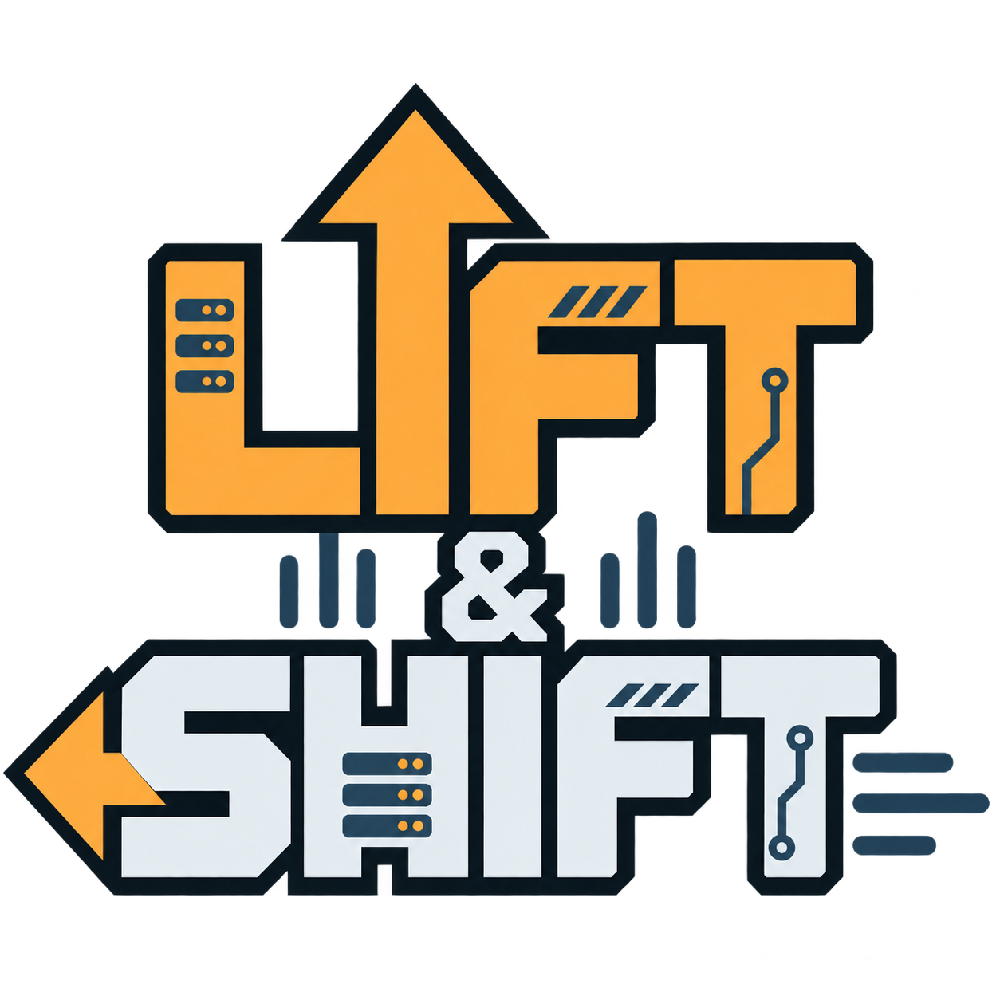
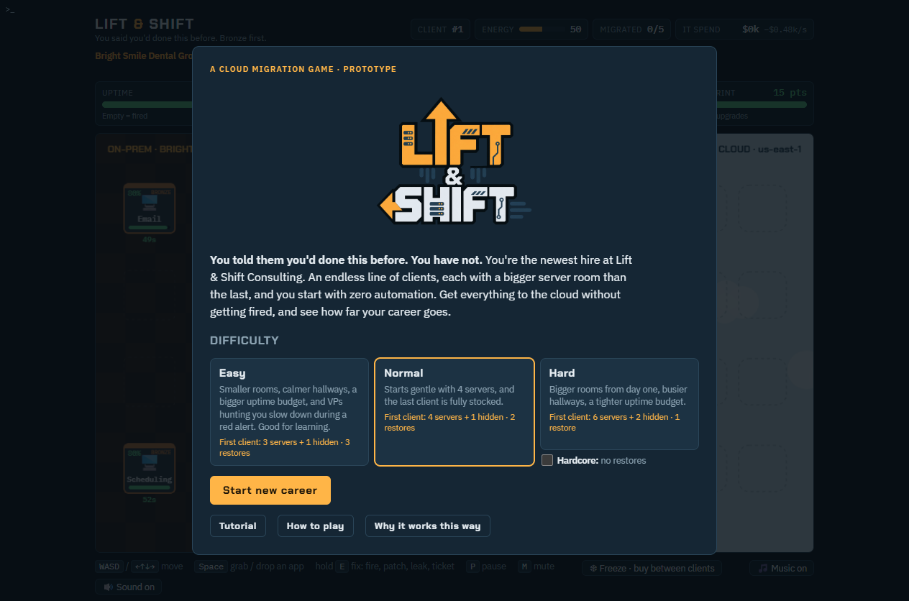
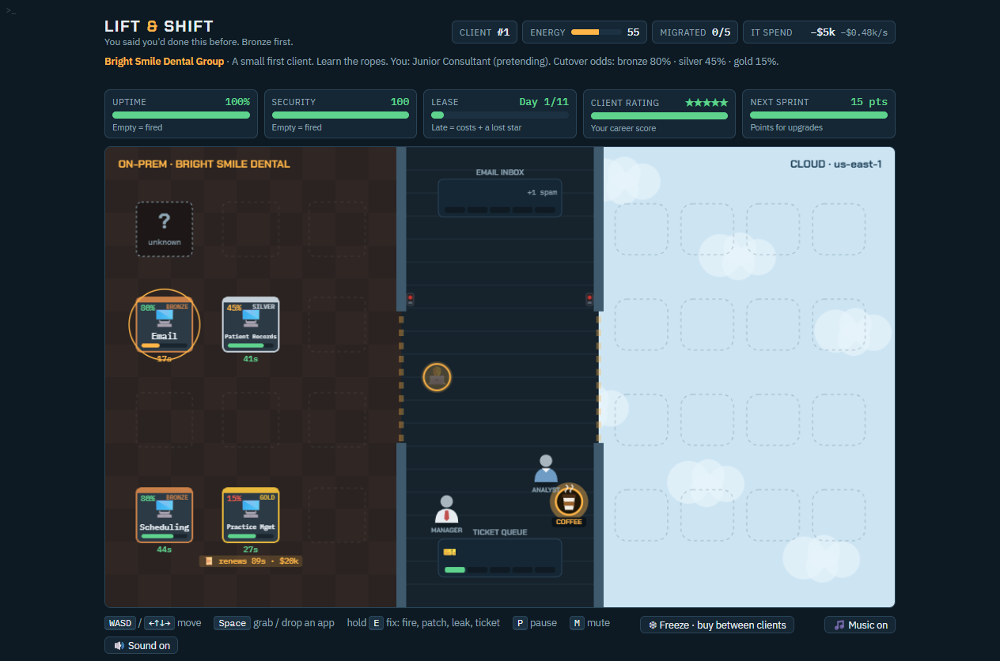

# [Play at las.milagrofrost.com](https://las.milagrofrost.com)

<p align="center"></p>

# Lift & Shift

A browser game about migrating applications to the cloud while keeping everyday IT operations running.

You are the newest consultant at Lift & Shift Consulting. The migration has a deadline. The business still needs its systems. Tickets, emails, patching, compliance, outages, security incidents, and people competing for your attention do not stop just because a migration project started.



## Why this game exists

Lift & Shift is a playful teaching simulation of **cloud migrations and business as usual (BAU)** for people working in IT, engineering, and DevOps. It makes competing responsibilities visible: delivering change, maintaining service, controlling spending, and protecting reliability all draw on the same limited attention.

The lesson is not to become a faster superhero. It is to build a better operating environment. Early in a career, you do most work yourself. Over time, investment in automation, policies, security controls, and people should free you to manage migrations and exceptions instead of continually fighting fires.

The game uses satire and compressed time. Its probabilities, costs, DORA-style ratings, and incident behavior are teaching devices, not production forecasts or real-world benchmarks. Cloud costs in particular are tilted optimistic. The game lets you approve FinOps downsizing by holding E and walking past servers; in real life, check utilization and test before you shrink anything. Please don't use them to plan a real migration, don't put them in a slide deck for your executives, and don't quote us.

## Hands on Tutorial

Open **Tutorials** on the main menu. It starts with a quick illustrated tour, and every page has **📎 Hands on Tutorial** beside **Main menu** for a guided practice client. You are in a reverse shadow: you do the work while a senior paperclip points out where to go and what to look for. On the map, its eyes follow you and blink occasionally. Coffee widens its eyes, red alerts make it quiver and quake with its eyes squeezed shut, peeking now and then, firefighting closes its eyes, hallway interruptions get an eye roll, and the leak lesson gets a repeating teardrop. Reduced motion keeps these reactions still and disables blinking. Practice movement, carrying and cutover, patch coverage, tickets, email, firefighting, discovery, coffee and cloud leaks, then read your client report and buy an upskill.

In practice nothing arrives on its own (tickets, email, users, pickups and leaks are staged one lesson at a time), compliance and license clocks are paused, and every cutover succeeds. The day clock runs and moving a server still burns a little uptime. The staged fire and leak grow a little slower than usual and never spread, but left alone the fire still burns through to an outage and the leak still becomes a breach and a red alert, which you then fix. Tutorial purchases and results do not carry into career records. Pause or leave whenever you like; real careers keep their normal timing and risks.

## Day 2 (prototype)

Type `git checkout day2` in the terminal and **🌙 Day 2 (prototype)** appears on the main menu, next to Start new career, until you reload. It is an early take on the second career. Teddy's Bright Smile Dental is back: it turns out they have a second clinic, across town, whose server closet never made the migration list. Their last temp, Doug, has to run its night shift alone. You have five days. Each one starts with a short handover on the familiar floor: start him on the easy stuff (patching), and once he's got that, move him up to tickets and fires, then to bringing servers back up. Patch a few with him beside you so he watches, then press Space at one and let him try while you supervise. Meanwhile keep the place running and build what will carry the load behind him: write the first version of each runbook, get the Patch Bot nobody configured working (that takes a couple of days), and stop the portal auto-approving everything. When Patch Bot hits a case it doesn't know it catches fire (the server's fine; the bot isn't) and gets stuck at that server; put it out, then teach it the case and it gets better, and once Doug has seen you do it he can teach it too. Press Space with nothing in front of you to send him off on his own while you do it: he covers what he can and it still goes in the runbook notes, but his skills stop growing until you call him back. You can't do it all in a day, and cramming fills his head until nothing more goes in. Then you go home and go to sleep while he works the night on the same simulation as Day 1. Doug doesn't go home: he shadows you all day and works all night on the hallway coffee, so whatever state the night leaves him in, that's who turns up. If he gets stuck, the phone rings in the dark. Every call you pick up costs you energy, sleep only brings it back slowly, and too tired you sleep straight through it, headphones on, the ring just part of the muffle; you start the morning with whatever the night left you. He calls from wherever the trouble is. Pick up and you open your eyes, groggy and out of focus, on the security camera: a close-up of him and his question, wherever he goes, until he's sorted and you drift off again. Everything he does or watches you do, day or night, and everything you talk him through, is experience; next morning, walk him to a runbook and he adds what he's learned. Your first version gets a runbook to 50%; only he can take it the rest of the way to 100%. It takes him a while, so you keep the floor going while he does. If he walks out, you talk him back in, and that costs you sleep too. He'll pick up twice; the third time, you redo that night. In the morning, whatever broke is still broken. The first nights will go badly; each should go a little less badly, and the month-end close on night five is the one that has to hold. Get there and his runbooks go up on Code Hub for whoever (or whatever) does the job next. Every night plays out the same way for the same handover, so redoing one shows exactly what a different choice changes.

## How it plays

1. Start a career and choose a difficulty. Your new VP's welcome email lists the whole job (migrate, patch, tickets, email, watch the cloud). It's never just the migration.
2. Pick up applications in the on-premises room and carry them through the hallway to the cloud.
3. Choose migration order carefully: bronze applications build experience for silver and gold cutovers.
4. Keep BAU moving: answer email, close tickets, patch systems, contain leaks, and restore service.
5. Recover failed cutovers in the cloud or roll them back on-premises.
6. Complete a client, review the results, and spend improvement points on tools and support for future clients. Finishing days ahead of the lease target wins back some points that incidents cost you.

Later clients bring larger environments, hidden applications, and more operational pressure. Tools carry forward. You can continue your consulting career or retire between clients.

There is one more way to win: automate yourself out of a job. A level 4 AI Agent with every foundation in place (plus Mover Bot for the migrations) can run a whole client by itself. Finish a client without doing a single thing yourself, and after the client review the AI agent gets you fired as obsolete instead of handing you the next client. Do even one thing and you stay employed. If you do under a quarter of the work, the review passes on a rumor about a "special" new role for people who just sit and watch. Or, at the meeting, take a pay cut and stay. Get there again and they'll offer another one, until you're paying them to work there.

Prefer to do it without AI? Tick **Old school** on the main menu: the AI Agent and AI Chatbots never reach the shop. From the 10th client on, if the bots and your tooling do the engineering and under 15% of your own work is skilled (migrations, incidents, leaks), the job is down to a checklist, and after the review it gets outsourced. That's a win as well, with its own old-school credits.

Curious what a tool really does? **📚 Learn more** on the main menu lists every upgrade with a link to a good real-world explanation (Comfy Sneakers included), and each shop card links to the same page. **🤝 Let's connect** has a very humble post from the person who made it, with links to [LinkedIn](https://www.linkedin.com/in/milagrofrost/) and [milagrofrost.com](https://milagrofrost.com).



## What you learn by playing

| Game system | Operational lesson |
| --- | --- |
| Migration tiers and failed cutovers | Sequence changes, understand risk, and keep a recovery path. |
| Hidden servers | Discovery and asset inventory matter before a migration. |
| Email, tickets, and interruptions | BAU competes with project delivery for real capacity. |
| Uptime and security | Shipping is not the only measure of success. |
| Licenses, running costs, and lease targets | Migration timing has financial consequences. |
| Cloud running costs | A plain lift-and-shift costs a little more than on-prem; Terraform, Observability, auto-patching, and approving FinOps rightsizing recommendations are what make the cloud cheaper. |
| Automation and upgrades | Tools need investment and iteration; mature automation should reduce toil. |
| Improvement points and retrospectives | Incidents consume capacity that could have prevented future incidents. |
| Delivery and recovery statistics | Review outcomes and improve the process, not just the speed of individual actions. |

## Play locally

Clone this repository, then open `lift-and-shift.html` in a modern browser. No build step or backend is required.

Alternatively, serve the folder locally with Python:

```sh
git clone https://github.com/milagrofrost/lift-and-shift-game.git
cd lift-and-shift-game
python -m http.server 8766 --bind 127.0.0.1
```

Open <http://127.0.0.1:8766/lift-and-shift.html>. On some systems, use `python3` instead of `python`.

Google Fonts supplies optional fonts; system font fallbacks are included. Sound and music are synthesized in the browser. The music is the author's own band's songs, one per client, rotating: each gets tenser as trouble builds and has its own red-alert version, the donut shop has its own tune, and Day 2's night shift has its own. Type `gitamp` in the terminal for a retro music player that plays any of them in any mood; its VIS button opens PacketDrop, a visualizer where packets swirl into the cloud and some get dropped. The game uses browser local storage for preferences and records, not a resumable career save. Refreshing starts over.

## Controls

| Input | Action |
| --- | --- |
| WASD or arrow keys | Move. While a user has you pinned for a "quick question", mash any direction (on a phone, wiggle the stick back and forth) to jerk away: the faster you mash, the sooner it ends, up to a quarter off the wait; shave the full quarter and they take the hint. The temp's question can't be shaken off. |
| Space / J | Grab, or drop while standing on an empty cloud slot or rack; hold near a failed cloud cutover to roll back |
| Hold E / K | Contextual work: patch, firefight, restore, contain, investigate, answer, or close |
| F | Use your Emergency Freeze charge (bought between clients) |
| P / Escape | Pause or resume. The pause menu's **Logging level** button sets how much text the floor shows: ERROR (incidents only), WARN (the default: short hints and problems), INFO (every hint, result and odds) or DEBUG (all of that, plus labels on everything, a metrics scrape of the floor, and a tail of the real event log, terminal included, in place of the pop-up messages; both panels tuck themselves away when you walk up to them). The hands-on tutorial always shows at least INFO. The 🌙 / ☀️ button switches between dark and light mode (saved for next time); turning the lights on comes with a moment of glare and ringing ears. |
| M | Toggle sound effects |
| ` (backtick) or the >_ button | Open the terminal: `journalctl` shows the event log, `restore mm:ss` goes back to a restore point |
| Music button | Toggle music |

On phones the game plays in landscape: drag anywhere on the left half of the screen to move, and use the see-through FIX (hold), GRAB, freeze and pause buttons on the right. FIX and GRAB name what they'd do where you stand (DOUSE, PATCH, SEAL, REPLY, REBOOT, RETRY, PROBE, UNJAM, APPROVE, SHOO; GRAB, SHIP, DEPLOY, DROP, TOSS, ROLLBACK) and go gray when there's nothing to do. On a touch screen the game's text names these buttons instead of keys: the hint over your head uses the word the button shows ("Hold DOUSE: extinguish"), and messages, help and the tutorials say FIX and GRAB. On iPhone and iPad, sound obeys the ring/silent switch like most casual games, and music from other apps keeps playing; the pause menu's Silent mode button (Safari 17+) can play sound anyway, which pauses other apps' audio. A one-time tip mentions it at your first career start. Tutorial, How to play, and Why it works this way explain the mechanics in-game. With the pipeline upgrade, Space at a rack sends it down a free lane (or you carry it if every lane is busy).

## Development status

The game is one HTML file containing the interface, canvas rendering, simulation, and audio; the logo and install icons live in `assets/`, along with `assets/day2.js`, the Day 2 prototype. PWA registration and offline caching live in `pwa.js` and `sw.js`.

The gameplay revisions are merged into `main`, including current-cycle patch coverage, incident completion rules, rollback accounting, manager change freezes, and persistent escalation targeting.

Play at **https://las.milagrofrost.com**. Cloudflare Pages automatically deploys pushes to `main`.

## Regression tests

`tests/regression.html` loads the game in a hidden frame and runs deterministic checks with a seeded random number generator: script syntax, patch coverage, completion and cutover accounting, carrying and escalations, blue-green copies, freezes, and hidden servers. Serve the repository root (see *Play locally*) and open <http://127.0.0.1:8766/tests/regression.html>. The page title reads `PASS n/n` or `FAIL k/n`, and `window.__RESULTS` holds the details for scripted runs.

`node tests/check-links.mjs` checks every outside link the game shows (the Learn more readings and the author links) and exits with an error if any is broken. It needs the internet, so it's separate from the regression page. Sites that block scripts, like LinkedIn, are listed as unverified rather than broken.

Run it before every push to `main`, and add a check whenever you change a rule it covers.

## Automated checks

Changes reach `main` only through pull requests, and four checks must pass first. [.github/README.md](.github/README.md) explains every workflow, the protection on `main`, and how to run each one locally. In short, each pull request runs [CI](.github/workflows/ci.yml):

- **Syntax, PWA and docs:** `node tests/syntax.mjs` parses every script, `node tests/pwa.mjs` checks the service worker, and a pull request that changes the workflows must update `.github/README.md`.
- **Regression:** `tests/regression.html` in Chromium and WebKit (Safari's engine). It must read `PASS`.
- **Desktop:** 1440×900, 1280×720 and reduced motion, in Chromium, WebKit and Firefox. Fourteen set-up scenes per screen (menu, tutorials, a fire, the ticket queue, a deploy, a failed cutover, a red alert, pause, the review, DEBUG, an end screen, How to play, the hands-on tutorial) with checks on what each one shows, plus a 20-second keyboard play session recorded as video.
- **Phone and tablet:** iPhone 15, iPhone SE, Pixel 7 and iPad in landscape, an iPhone held upright, and reduced motion. The same scenes, checking the touch words and gray-out and that the buttons never move. A 20-second touch play session with video, and an offline reload through the same redirects Cloudflare Pages serves.

Screenshots, play videos and the Playwright report are published as a gallery page on Cloudflare Pages (`https://pr-<number>.las-test-screenshots.pages.dev`, once the Cloudflare secrets are set up) and attached to each run as zips, and a pull request gets one comment with the results and a few screenshots inline. A pull request that changes the game also gets a **balance** comment: a bot plays 100 seeded careers on `main` and on the change and flags big swings in survival, incidents and spend. After each merge, a **live site** check waits for the Cloudflare deploy and smoke-tests production (opening, offline, share links); it also runs daily. `node tests/check-links.mjs` runs weekly.

To run the browser tests locally (needs Node 22):

```bash
npm ci
```

```bash
npx playwright install chromium webkit firefox
```

```bash
npx playwright test -c tests/e2e
```

Add `--project=desktop-*` or `--project=phone-*` to run one group. Screenshots land in `tests/e2e/out/`. The scenes reuse the regression page's `HOOK` and `NAMES`, so they need no changes to the game. Emulated phones aren't real iPhones: the silent switch, `navigator.audioSession`, Home Screen mode and real touch feel still need a check on a device.

## Contributing, including AI assistants

Use [DESIGN.md](DESIGN.md) for the shared visual and interaction standard. The [design audit](docs/design-audit.md) tracks consistency findings, evidence, and checks still needed.

Read [AGENTS.md](AGENTS.md) before making changes. It records the teaching goals, agreed gameplay direction, branch expectations, and validation guidelines. Preserve the relationship between mechanics and the operational lesson they are intended to teach. Explain balance changes and test their interactions instead of treating isolated functions as the whole game.

### Blue-green staging
With Blue-Green Cutovers, you carry (or pipeline) a see-through copy while the original stays online in its rack until a successful cutover retires it. The original can still catch fire and take escalations while the copy is in flight; if it goes offline, the copy is canceled and you restore it and migrate again. Failed cloud deployments stay gray; hold E there to retry. Migrating a currently patched server reduces new-leak risk by 50% for the first 30 seconds after cutover.

### CI/CD pipeline
The CI/CD Pipeline upgrade puts a conveyor across the hallway: press Space at a rack and a free lane carries the server to the cloud (about 6 seconds, 3 with Terraform, +10% cutover odds). It worked when we tested it. Results may vary: every send rolls once, and 15–20% of them jam partway across. A jammed lane stops with its server stuck on the belt, still in the pipeline for every other rule: it is shut down and burns uptime at the migration rate (a blue-green copy burns nothing), its license stays paused, and escalations keep tracking it. Stand anywhere on that conveyor and hold E to repair it (free, about 2.5 seconds, progress kept if you let go); the server then rides on. Repairs are skilled, hands-on work. A level 3+ AI Agent can repair it too; temps, Patch Bot and Mover Bot can't, freezes don't, and no upgrade lowers the odds. Each extra level adds a lane that jams on its own, and the Mover Bot waits for a free lane, so a jammed one holds it up. A jammed lane sounds a factory buzzer every few seconds until it's repaired; it goes quiet while someone is repairing it and under a red alert's siren.

### The AI Agent
The AI Agent unlocks after the third client and amplifies the practices you already have. It works the email and ticket queues whenever either is at least half full; otherwise it goes looking for fixes on-prem and in the cloud (leaks, Patch Bot automation errors, overdue patches) before clearing whatever is left. Level 2 also investigates unknown racks start to finish, unlike a temp. When it breaks something it apologizes (billed in tokens) and tries once to fix it, but some things are beyond it: level 1 can't bring back a server it knocked offline, and below level 3 it can't put out a fire its escalation started ("Sorry, I can't fix that."). Level 3 chases an escalation it caused to the server and puts the fire out there with its digital extinguisher, and repairs a jammed CI/CD pipeline. Level 4 adds guardrails and answers incidents too: fires, outages, breaches and failed cutovers. At level 4 you can also fire your manager between clients: the automatic change freezes, the faster uptime recovery and the agent's email know-how stay, and the wandering, chatting, guarding and server "inspections" go. Level 4 also splits itself into a swarm: it forks a copy for every job nobody's on (incident, ops, secops, FinOps, pipeline, service desk; up to 8 at once), and it takes over your Patch Bot and Mover Bot, which turn purple, sparkle and get a lot faster. Every copy and every bot job bills tokens: clients go much faster and cost much more.

From the 8th client on, if you own the AI Agent (or play old school), the retrospective can offer **Continuous improvement**: a permanent commitment that locks in the tools you're still levelling up. Every shop after that keeps two slots for tools you don't own yet and fills the rest with your locked-in tools until they're all maxed.

### Mr Paperclip
Graduated from the tutorial, the senior paperclip is for sale: **Mr Paperclip · Reverse Shadow**, a 2-point one-off in the improvement sprint (not an AI upskill, so old school careers get him too). He floats at your shoulder in every client with all his tutorial faces (eyes that follow you, wide on coffee, shut and shaking in red alerts, closed while extinguishers spray, an eye roll for hallway users, tears for leaks) and comments in a speech bubble on a good chunk of what happens, backseat-driver style (second-guessing your choices, micromanaging while you hold E, claiming credit, hindsight, unsolicited advice like "Have you considered Kubernetes?"): migrations, failed cutovers, escalations ("Thar she blows!"), outages, email, VPs, pizza and more. His advice is comedy and mostly wrong. His one real effect: every line is worth +1 energy. Ordinary lines wait 8–12 seconds; alarms jump the queue. There is no mute. In the shop he has opinions about what you buy, and the old school credits hold a memorial for him with his days on the team.

### VPs and the inbox
When the inbox is full, the VP (in the bright blue suit; the navy suits in the hallway are Senior Directors) walks in from the far end of the hallway to find you. Answer enough email to get under the limit (or let them hold you once) and they walk back out the way they came. Let the inbox fill up again before they're gone and the same VP turns right back around.

### Red-alert slow-mo
On Easy, and a little on Normal, VPs coming to find you slow down during a red alert (60% speed on Easy, 85% on Normal), so you get more time to fix the incident before one grabs you. Everyone else, and your repairs, run at normal speed. A slow heartbeat fades in, the music loses its bass and kick and goes muffled, and the edges of the room darken. When the alert clears it eases back out and the heartbeat quickens and fades away. Hard has none.

Each server-room door has a badge reader on the hallway side. Walking in plays a faint ting and the light goes green for a second; walking out turns it green too, silently, like a real exit sensor. You, your manager and VPs all badge in normally. The Badge Access Audit upgrade only delays VPs: one hunting you stands beside the door, gets denied three times (3 seconds apart), calls Bob in Facilities, and then walks in and keeps following you until they catch you or give up as usual. While the light is green, a VP can piggyback through, including when you step out past one waiting at the door. Your manager keeps their badge.

### Restore from backup
The terminal keeps a play-by-play event log for the current client and a restore point (💾) roughly every 30 seconds. Selecting one plays a "Restoring to mm:ss state" progress bar and returns the game to that moment. You get three restores per career on Easy, two on Normal, one on Hard, and none with the Hardcore checkbox (Hard otherwise unchanged). They also work from the screen where you get fired. Restore points don't cross client boundaries, and the future can play out differently after a restore.

### Humble brag
If you get fired or resign mid-client, the report also counts what you're leaving behind as "Not my problem": everything flashing red as you walk out — visible racks that are uncovered and showing the red circle (the last quarter of their compliance cycle), and cloud leaks with a red border, about to be breached. You migrated what you could; those are for whoever gets hired next. On the resignation exit interview's carnage report each one adds a carnage point.

Every end screen (retired, fired, obsolete, outsourced, or resigned) has a share panel with a post written for LinkedIn, Facebook, X, or Instagram. Getting fired is reported as "Open to work"; the numbers are real. Each post links to a personal `/r/...` page whose 1200×630 preview image shows that report, so it appears as the picture on LinkedIn, Facebook, and X. No network lets a website attach an image directly: LinkedIn and X open with the post filled in and the square card on the clipboard to paste instead, Facebook takes only the link with the post on the clipboard, and Instagram uses the phone share sheet or a manual upload. Nothing is published until you do it yourself.

The report page and image are Cloudflare Pages Functions in `functions/`, with no dependencies or build step. Report links hold only numbers and fixed choices. To try them locally, run `npx wrangler pages dev .`; a plain static server doesn't run them.

### Older versions
The dropdown at the top right of the main menu plays the game as it was at any earlier change: "Latest" is what's live, and older versions are listed by date and commit. Each opens at `/v/<commit>/`, served straight from this repository's history by a Pages Function (`functions/v/`), so every commit is playable without its own deployment. Once a version has been opened, Cloudflare keeps it cached, so it loads quickly and keeps working even if GitHub is unavailable; the live game is never cached this way, so updates show up as soon as they deploy. Older versions keep their own saved records and settings, so trying one never touches your current best scores. Pick Latest to come back. Optionally, set a `GITHUB_TOKEN` secret on the Pages project to raise GitHub's rate limit for the version list.

### Terminal help
Type `?` in the terminal to list its commands, a command and `?` for its options (`ping ?`), or part of a word and `?` to match by prefix (`p?`). Help answers as soon as you press `?` and keeps your line. Most of the commands are jokes (try `cowsay`, `history` or `dig`), and none of them can change your game.

### Hidden-server discovery
Unknown racks require investigation (hold E for 6 seconds; 3 with Asset Inventory). The three handmade clients keep their designed hidden-server tiers; from client 4 on, hidden servers can be any tier. Discovery can expose an already-expired license with renewal liability, or a license close to expiry. Investigate quickly and you can beat the renewal; leave it, or let an outage find it, and the license has probably already renewed. Escalations can attack hidden racks; a resulting outage reveals the server. Migration progress never reveals them automatically.


## Install and play offline

After deployment, open https://las.milagrofrost.com once while online and allow the initial game download to finish.

- **Android (Chrome):** open the browser menu and choose **Add to Home screen → Install** (wording may vary). Launch Lift & Shift from its new icon.
- **iPhone (Safari):** tap **Share → Add to Home Screen**, leave **Open as Web App** enabled if shown, then tap **Add**. Launch from the home screen.
- **Desktop (Chrome/Edge):** use the address-bar install icon or the browser menu's install option.

Rotate phones to landscape to play; portrait keeps the existing rotation prompt. Standalone windows respect notch and home-indicator safe areas. Sound, pause, keyboard/touch controls and reduced motion work as in the browser.

The game and logo/icons work offline after the first successful download. External fonts fall back to system fonts; Learn more, social links and shared report pages/images require the internet. Installation does not add career save/resume: reloading or closing still ends the current run. Browser records and preferences remain local; an installed app may have separate storage, especially on iPhone. The operating system can clear offline storage.

Updates never reload an active game. Online launches fetch the current deployment. An updated worker takes over right away but never reloads or messages an open game; it only answers the next request. Bump the cache version in sw.js whenever any precached file changes. Cache cleanup only deletes this game's old shell caches; report Functions and unknown routes are never intercepted. No Cloudflare build step or dependencies are added; _headers ensures worker/manifest revalidation. Cloudflare Pages redirects the .html launch URL to its extensionless equivalent (308). The worker passes that redirect through and stores only plain, unredirected copies, because Safari refuses to show a redirected response from a service worker ("Response served by service worker has redirections"). Both URLs work offline.

### PWA validation

Run node tests/pwa.mjs for dependency-free packaging and service-worker policy checks, and run tests/regression.html over HTTP for gameplay regressions. Service workers require HTTPS or localhost; opening files directly still plays the game without offline installation.

On a localhost server or an HTTPS branch preview, open the game, wait for the service worker to finish installing (DevTools → Application → Service Workers), and reload once so it controls the page. Check the manifest and icons in Application → Manifest. Switch DevTools Network to Offline and reload both / and /lift-and-shift.html: the game and logo must load and a new run must work. /r/... must remain network-only. Restore the network, test touch controls in landscape, rotate to portrait, and check standalone safe areas on a physical phone. Test an update with two windows open: neither should reload, and the next navigation should be answered by the new worker. Test behind a redirect too (or on the Pages preview): open /, then /lift-and-shift.html, online and offline. Use a separate preview/localhost origin for tests to preserve active production runs.
